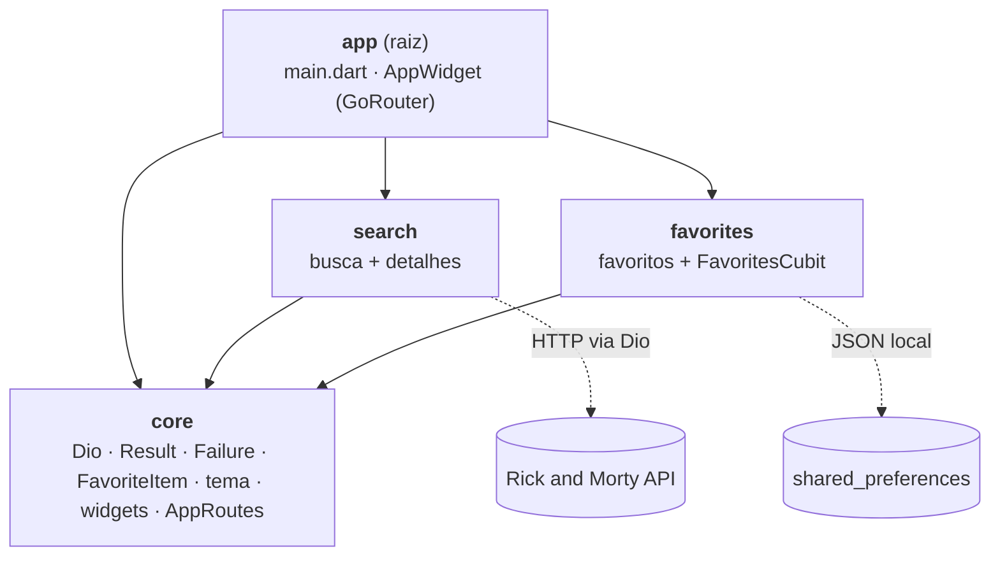
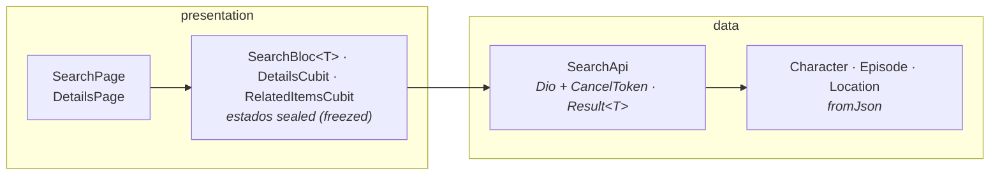

# Rick and Morty App

App Flutter para buscar **personagens, episódios e locais** da [Rick and Morty API](https://rickandmortyapi.com/), ver detalhes e salvar favoritos.

O que mudou em cada versão está no [CHANGELOG](CHANGELOG.md).

## Funcionalidades

- Página inicial no layout do protótipo do Figma: topo com seletor de tema **Escuro / Claro**, busca única com filtros (**Personagens / Localizações / Episódios**) e seções com prévia de cada tipo e **Ver todos**
- Busca por nome com **debounce de 400 ms** e **cancelamento** da requisição anterior
- **Paginação** com scroll infinito (`info.next` da API) e "tentar novamente" quando uma página falha
- Estados de **carregamento** (skeleton), **erro** com retry, **vazio** e **não encontrado** (a API responde 404 quando nada casa com a busca)
- **Detalhes** de cada item no layout do protótipo (personagem com cards de origem e última localização; episódio; local), com seção **"Mais ..."** e **paginação numerada**; acessíveis da busca, dos favoritos ou por deep link (`/details/:type/:id`)
- **Favoritos** persistidos localmente: salvar, listar, remover; o coração fica sincronizado em todas as telas
- Tema **claro/escuro** persistido, fonte Inter empacotada no app (funciona offline), cache de imagens em disco
- **Sem rede**, buscas e detalhes já vistos continuam aparecendo: cada resposta da API fica em cache e é usada quando a conexão falha, com uma faixa no rodapé avisando "Sem conexão. Mostrando os dados salvos."
- **Responsivo**: lista em celular, grade de 2 a 4 colunas em tablet/paisagem; detalhes lado a lado em telas largas

## Telas

<table>
  <tr>
    <th>Início (escuro)</th>
    <th>Início (claro)</th>
    <th>Busca</th>
  </tr>
  <tr>
    <td></td>
    <td></td>
    <td></td>
  </tr>
  <tr>
    <th>Personagem</th>
    <th>Episódio</th>
    <th>Local</th>
  </tr>
  <tr>
    <td></td>
    <td></td>
    <td></td>
  </tr>
  <tr>
    <th>Favoritos</th>
    <th></th>
    <th></th>
  </tr>
  <tr>
    <td></td>
    <td></td>
    <td></td>
  </tr>
</table>

> Capturas do app rodando com dados reais da API, em tela de celular (390 × 844).

## Requisitos

| Ferramenta | Versão usada |
| --- | --- |
| Flutter | 3.47.9 (mínimo 3.41) |
| Dart | 3.13.7 (mínimo 3.8) |
| Melos | 8.10.1 |

## Como rodar

```bash
dart pub global activate melos
melos bootstrap
flutter run
```

Os arquivos gerados (`*.freezed.dart`, `*.g.dart`) estão versionados, então não é preciso gerar código para rodar. Para regenerar depois de mudar um model:

```bash
melos run gen
```

## Testes e análise

```bash
melos run analyze    # dart analyze --fatal-infos em todo o workspace
melos run test       # flutter test no app (raiz) e em cada pacote
melos run coverage   # testes com cobertura; falha abaixo de 80%
```

### Cobertura

| Pacote | Linhas cobertas |
| --- | --- |
| app (raiz) | 100,0% |
| core | 92,3% |
| favorites | 98,0% |
| search | 95,9% |
| **Total** | **94,8%** (1370/1445) |

O `melos run coverage` roda os testes de cada pacote e junta tudo em `coverage/lcov.info` na raiz, sem os arquivos gerados (`*.g.dart`, `*.freezed.dart`). O script [`tool/coverage_report.dart`](tool/coverage_report.dart) também avisa quando um arquivo com código não é carregado por nenhum teste, já que esses arquivos não aparecem no `lcov.info` e inflariam o percentual. No CI o relatório fica disponível como artefato (`coverage-lcov`) e o build falha abaixo de 80%.

Para ver por arquivo: `dart run tool/coverage_report.dart --files`.

Os testes cobrem as models com JSON real da API (`test/fixtures`), o `SearchApi` e o `FavoritesStorage` (sucesso, 404, timeout, sem rede, cancelamento, armazenamento corrompido), o `SearchBloc` (debounce, resposta antiga descartada, paginação), as rotas de cada feature (com o Dio de verdade sobre fixtures), o `AppWidget` (rotas, tema salvo, favoritos na abertura) e as telas em cada estado (incluindo layout de tablet).

## Arquitetura

A raiz do repositório é um projeto Flutter padrão (o app). As features ficam em pacotes locais em `packages/`, ligados por **pub workspaces + Melos**. Cada feature tem só duas camadas: `data` (consumo da API ou do armazenamento local + models) e `presentation` (Bloc/Cubit, páginas e widgets).

```
lib/                          # o app
  main.dart                   # carrega o CoreDependencies e chama runApp
  app/app_widget.dart         # GoRouter, ThemeCubit e FavoritesCubit globais, FavoriteButtonProvider
test/                         # testes do AppWidget (rotas, tema salvo, favoritos na abertura)
android/  ios/                # projetos nativos
packages/
  core/                       # base compartilhada; as features só dependem dele
    assets/fonts/             # Inter e ícones Phosphor (com as licenças)
    lib/src/
      di/                     # CoreDependencies (SharedPreferences + Dio)
      error/                  # Failure
      navigation/             # AppRoutes
      network/                # createDio, retry em 429, cache offline, DioException → Failure
      strings/                # AppStrings: todos os textos de tela
      theme/                  # AppTheme, AppColors, ThemeCubit e seletores de tema
      types/                  # Result, PaginatedList, ResourceType, FavoriteItem (Dart puro)
      ui/                     # widgets genéricos: MessageView, LoadingSkeleton, FavoriteSlot...
  favorites/
    lib/src/
      data/                   # FavoritesStorage (JSON no shared_preferences)
      presentation/           # FavoritesCubit, FavoritesPage, FavoriteButton
      favorites_routes.dart   # rota /favorites
  search/
    lib/src/
      data/
        models/               # Character, Episode, Location (fromJson)
        search_api.dart       # SearchApi: busca e detalhes na Rick and Morty API
      presentation/
        bloc/                 # SearchBloc, DetailsCubit, RelatedItemsCubit e seus estados
        pages/                # SearchPage, DetailsPage
        widgets/              # uma pasta por tela: cards/, home/, search/, details/
      search_routes.dart      # rotas / e /details/:type/:id
    test/fixtures/            # JSON real da API usado nos testes
tool/coverage_report.dart     # junta a cobertura do app e dos pacotes
.github/                      # CI, release e Dependabot
```

### Desenho da arquitetura

Dependências entre os pacotes (a seta aponta para quem é usado):



O `search` e o `favorites` não dependem um do outro. O `search` põe um `FavoriteSlot` (do `core`) onde vai o coração, e o app, na raiz, envolve as telas num `FavoriteButtonProvider` (do `favorites`), que desenha o `FavoriteButton` em cada slot.

Camadas dentro de cada feature (exemplo do `search`): a tela lê o estado do Bloc/Cubit, que chama o `SearchApi` e recebe as models prontas.



- **Models** (`data/models`): uma classe por recurso da API (`Character`, `Episode`, `Location`, `FavoriteItem`), com `fromJson` e igualdade por valor (freezed). A UI usa as models direto; não há entidades separadas.
- **`SearchApi` e `FavoritesStorage`**: falam com a API e com o `shared_preferences` e nunca lançam exceção. Devolvem um `Result<T>` do `core`: `Success(data)` ou `Failed(failure)`, tratados com `switch`.
- `Failure` é uma sealed class (freezed): `notFound`, `network`, `tooManyRequests`, `server`, `cancelled`, `cache`, `unexpected`. O 404 da busca vira o estado **não encontrado**, não um erro genérico. O texto mostrado ao usuário fica na `FailurePresentation`, na UI.
- Estados de tela são sealed classes do freezed, tratados com `switch` exaustivo.
- Widgets de tela ficam em `presentation/widgets`, uma pasta por tela: `cards/` (cards de resultado e helpers), `home/`, `search/` e `details/`. As páginas só montam esses widgets e ligam os Blocs/Cubits; widgets genéricos (sem dependência de feature) ficam em `core/lib/src/ui`.

### Fluxo de uma busca

1. `SearchPage` envia `SearchQueryChanged` ao Bloc da aba visível.
2. O `SearchBloc<T>` aplica `debounce` (400 ms) + `restartable` (só a última busca importa).
3. O `SearchApi` cancela o `CancelToken` anterior do mesmo tipo, faz a requisição e devolve `Result<PaginatedList<T>>`, com a `DioException` já convertida em `Failure`.
4. O Bloc descarta respostas antigas (contador de geração) e emite `loading` → `success` / `empty` / `notFound` / `error`.

Um único `SearchBloc<T>` genérico atende as três abas: cada aba recebe o método do `SearchApi` do seu tipo (`searchCharacters`, `searchEpisodes`, `searchLocations`).

### Decisões

| Decisão | Motivo |
| --- | --- |
| `go_router` + `BlocProvider`, sem container de DI | O `main()` cria um `CoreDependencies` (`SharedPreferences` + `Dio`) e o passa para o `AppWidget` e para as rotas (`searchRoutes(core)`, `favoritesRoute()`). Cada tela cria seus Blocs/Cubits no `BlocProvider.create` (ex.: `DetailsCubit(SearchApi(core.dio))`) e o `BlocProvider` os fecha: um único mecanismo de ciclo de vida. Substituiu o `flutter_modular` 6.x, que duplicava o DI e exigia o `hide ModularWatchExtension`. |
| Fonte Inter empacotada (não `google_fonts`) | Os TTFs estáticos (pesos 400, 500, 700 e 800, licença SIL OFL) ficam em `packages/core/assets/fonts`: sem requisição nem troca de fonte no primeiro uso offline ou com rede lenta. A licença aparece na página de licenças do app (`AppTheme.registerFontLicenses`). |
| `flutter_bloc` + estados `sealed` | Cubits para carregar dados; Bloc só na busca, onde os transformers de evento dão debounce, `restartable` e `droppable` sem `Timer` à mão. |
| Sem camada `domain` | O app só exibe dados da API: entidades, use cases e contratos de repositório duplicavam as models e repassavam chamadas sem nenhuma regra. |
| Cache da API em arquivos, rede primeiro | Sempre tenta a rede; o cache só responde quando ela falha, então os dados nunca ficam velhos com conexão. Um arquivo por URL na pasta de cache do app (e não no `shared_preferences`, que regravaria tudo a cada resposta); o sistema pode limpar essa pasta quando falta espaço. |
| Textos numa classe de constantes, no `core` | Todas as features já dependem do `core`, então uma única `AppStrings` (`static const` por texto; funções para os que têm valor, como `AppStrings.resultCount(n)`) atende o app inteiro, sem arquivo de tradução nem código gerado. Os tipos (`Failure`, `ResourceType`, `CharacterStatus`) não têm texto: a UI os traduz (`failure.message`, `AppStrings.resourceLabel(type)`, `statusLabel(status)`). Os textos do Material saem em pt pelo `flutter_localizations` no `AppWidget`. |
| `Result<T>` próprio (não `dartz`) | `Success`/`Failed` dizem o que cada caso é, ao contrário de `Left`/`Right`, e o `switch` do Dart trata os dois sem `fold`. |
| Favoritos com `shared_preferences` (JSON) | Simples e suficiente para o volume; o `FavoriteItem` guarda um snapshot mínimo (tipo, id, nome, subtítulo, imagem) para listar sem rede. |
| Detalhes carregam por `(tipo, id)` | A mesma rota serve para busca, favoritos e deep link. |
| Arquivos gerados versionados | O avaliador consegue rodar sem `build_runner`. |

> **Fonte e cores:** `AppTheme.fontFamily` (Inter) e as cores em `AppColors` foram tiradas do protótipo do Figma por inspeção visual e ainda serão conferidas no inspetor; trocar ali atualiza o app inteiro.

## Convenções

- Commits em [Conventional Commits](https://www.conventionalcommits.org/) (inglês)
- Uma branch só, a `main`: cada tarefa sai em uma `feature/*` ou `fix/*` criada a partir dela e volta por PR, com o CI (`ci.yml`) passando
- Release: tag `v*` em um commit da `main` (`release.yml`)

## Próximos passos

O que ainda está em aberto:

| Ponto | Situação | Próximo passo |
| --- | --- | --- |
| API key do Firebase no histórico do git | O `google-services.json` saiu do repositório, mas a chave continua nos commits antigos. | Restringir a chave no Google Cloud Console (pacote Android + SHA-1 do certificado) ou apagá-la, já que o app não usa nenhum serviço do Firebase além do App Distribution. |
| Quem pode criar tags `v*` | O `release.yml` já recusa tags fora da `main`. | Criar um ruleset de tags `v*` no GitHub (Settings → Rules → Rulesets → New tag ruleset) restringindo quem pode criá-las e apagá-las. |
| Registro de erros inesperados | O `Result.reportError` grava no log do `dart:developer`. | Apontar o `Result.reportError` para um serviço de crash report, se o app passar a ter um. |
| Outros idiomas | Os textos estão em `AppStrings`, só em português. | Se o app ganhar outro idioma, trocar as constantes por arquivos de tradução (ARB + `flutter gen-l10n`). |
