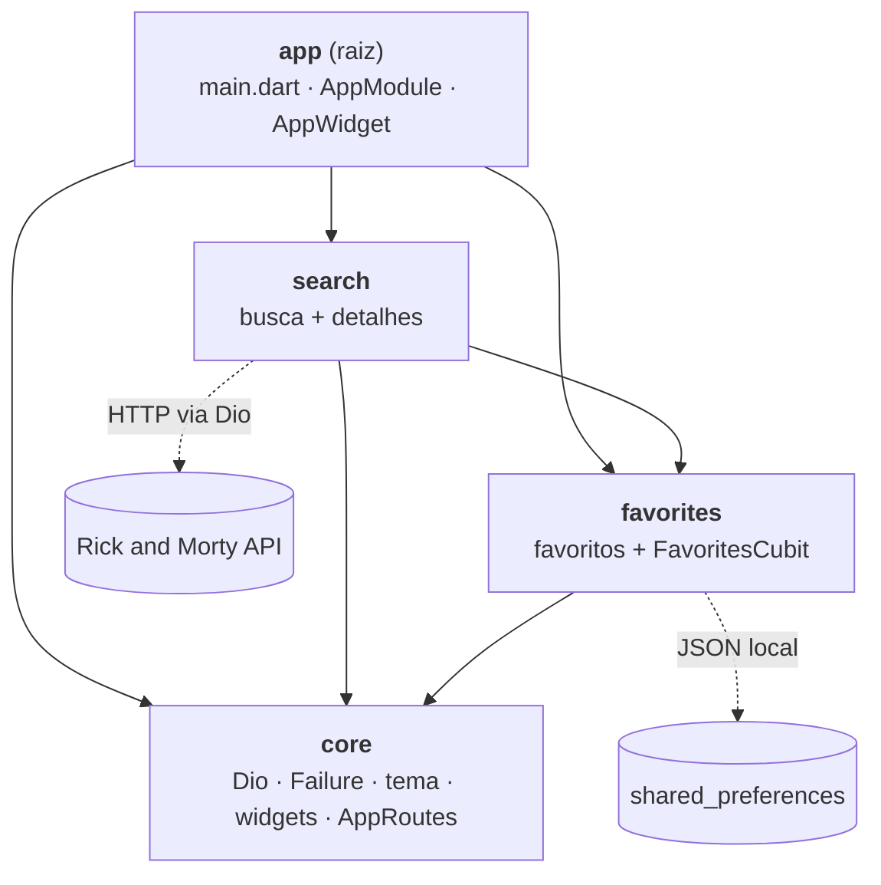
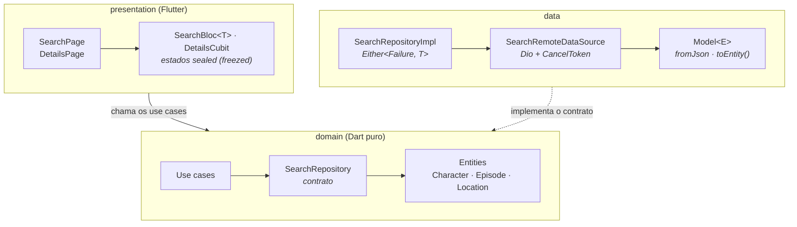

# Rick and Morty App

App Flutter para buscar **personagens, episódios e locais** da [Rick and Morty API](https://rickandmortyapi.com/), ver detalhes e salvar favoritos.

## Download

[Baixar APK (última versão)](https://github.com/cleberson-lima/rick_and_morty_app/releases/latest/download/app-release.apk)

> O link aponta sempre para a release mais recente em [GitHub Releases](https://github.com/cleberson-lima/rick_and_morty_app/releases) e passa a funcionar após a publicação da primeira versão. O que mudou em cada versão está no [CHANGELOG](CHANGELOG.md).

## Funcionalidades

- Página inicial no layout do protótipo do Figma: topo com seletor de tema **Escuro / Claro**, busca única com filtros (**Personagens / Localizações / Episódios**) e seções com prévia de cada tipo e **Ver todos**
- Busca por nome com **debounce de 400 ms** e **cancelamento** da requisição anterior
- **Paginação** com scroll infinito (`info.next` da API) e "tentar novamente" quando uma página falha
- Estados de **carregamento** (skeleton), **erro** com retry, **vazio** e **não encontrado** (a API responde 404 quando nada casa com a busca)
- **Detalhes** de cada item no layout do protótipo (personagem com cards de origem e última localização; episódio; local), com seção **"Mais ..."** e **paginação numerada**; acessíveis da busca, dos favoritos ou por deep link (`/details/:type/:id`)
- **Favoritos** persistidos localmente: salvar, listar, remover; o coração fica sincronizado em todas as telas
- Tema **claro/escuro** persistido, Google Fonts, cache de imagens em disco
- **Responsivo**: lista em celular, grade de 2 a 4 colunas em tablet/paisagem; detalhes lado a lado em telas largas

## Telas

<table>
  <tr>
    <th>Início (escuro)</th>
    <th>Início (claro)</th>
    <th>Busca</th>
  </tr>
  <tr>
    <td></td>
    <td></td>
    <td></td>
  </tr>
  <tr>
    <th>Personagem</th>
    <th>Episódio</th>
    <th>Local</th>
  </tr>
  <tr>
    <td></td>
    <td></td>
    <td></td>
  </tr>
  <tr>
    <th>Favoritos</th>
    <th></th>
    <th></th>
  </tr>
  <tr>
    <td></td>
    <td></td>
    <td></td>
  </tr>
</table>

> Capturas do app rodando com dados reais da API, em tela de celular (390 × 844).

## Requisitos

| Ferramenta | Versão usada |
| --- | --- |
| Flutter | 3.47.9 (mínimo 3.41) |
| Dart | 3.13.7 (mínimo 3.8) |
| Melos | 8.10.1 |

## Como rodar

```bash
dart pub global activate melos
melos bootstrap
flutter run
```

Os arquivos gerados (`*.freezed.dart`, `*.g.dart`) estão versionados, então não é preciso gerar código para rodar. Para regenerar depois de mudar um model:

```bash
melos run gen
```

## Testes e análise

```bash
melos run analyze    # dart analyze --fatal-infos em todo o workspace
melos run test       # flutter test em cada pacote
melos run coverage   # testes com cobertura; falha abaixo de 80%
```

### Cobertura

| Pacote | Linhas cobertas |
| --- | --- |
| core | 89,9% |
| favorites | 93,2% |
| search | 91,7% |
| **Total** | **91,3%** (1256/1375) |

O `melos run coverage` roda os testes de cada pacote e junta tudo em `coverage/lcov.info` na raiz, sem os arquivos gerados (`*.g.dart`, `*.freezed.dart`). O script [`tool/coverage_report.dart`](tool/coverage_report.dart) também avisa quando um arquivo com código não é carregado por nenhum teste, já que esses arquivos não aparecem no `lcov.info` e inflariam o percentual. No CI o relatório fica disponível como artefato (`coverage-lcov`) e o build falha abaixo de 80%.

Para ver por arquivo: `dart run tool/coverage_report.dart --files`.

Os testes cobrem modelos com JSON real da API (`test/fixtures`), repositórios (sucesso, 404, timeout, sem rede, cancelamento), o `SearchBloc` (debounce, resposta antiga descartada, paginação), a injeção de dependências de cada módulo e as telas em cada estado (incluindo layout de tablet).

## Arquitetura

A raiz do repositório é um projeto Flutter padrão (o app). As features ficam em pacotes locais em `packages/`, ligados por **pub workspaces + Melos**, cada um com **Clean Architecture** (`data` / `domain` / `presentation`).

```
lib/                 # app: main.dart, AppModule (rotas), AppWidget (tema, cubits globais)
android/  ios/       # projetos nativos
packages/
  core/              # Dio, Failure, ResourceType, PageResult, tema, design system, AppRoutes
  favorites/         # favoritos (shared_preferences) + FavoritesCubit global
  search/            # busca + detalhes (Rick and Morty API)
tool/                # scripts de desenvolvimento (relatório de cobertura)
```

### Desenho da arquitetura

Dependências entre os pacotes (a seta aponta para quem é usado):



Camadas dentro de cada feature (exemplo do `search`). As duas camadas de fora dependem do `domain`, e o `domain` não depende de nenhuma: a `presentation` chama os use cases, e a `data` implementa o contrato do repositório.



- `domain` é Dart puro: importa só `package:core/domain.dart` (sem Flutter, sem Dio).
- Repositórios retornam `Either<Failure, T>` (dartz) e nunca lançam exceção.
- `Failure` é uma sealed class (freezed): `notFound`, `network`, `server`, `cancelled`, `cache`, `unexpected`. O 404 da busca vira o estado **não encontrado**, não um erro genérico.
- Estados de tela são sealed classes do freezed, tratados com `switch` exaustivo.

### Fluxo de uma busca

1. `SearchPage` envia `SearchQueryChanged` ao Bloc da aba visível.
2. O `SearchBloc<T>` aplica `debounce` (400 ms) + `restartable` (só a última busca importa).
3. O `SearchRemoteDataSource` cancela o `CancelToken` anterior do mesmo tipo antes de disparar a nova requisição.
4. O repositório converte `DioException` em `Failure` e devolve `Either<Failure, PageResult<T>>`.
5. O Bloc descarta respostas antigas (contador de geração) e emite `loading` → `success` / `empty` / `notFound` / `error`.

Um único `SearchBloc<T>` genérico atende as três abas; cada aba tem seu próprio use case.

### Decisões

| Decisão | Motivo |
| --- | --- |
| `flutter_modular` **6.4** (não 7.x) | A 7.x é uma reescrita marcada como "work in progress" e define `context.read/watch` que conflitam com o flutter_bloc. A 6.x é estável e é a API conhecida (`Module`, `binds`, `routes`). |
| `google_fonts` **8.x** (não 9.x) | A 9.x usa o pacote `material_ui`, cujo `TextTheme` é um tipo diferente do `TextTheme` do SDK (`package:flutter/material.dart`). |
| `flutter_bloc` + estados `sealed` | Eventos rastreáveis, `bloc_test`, transformers de concorrência (`restartable`, `droppable`). |
| Favoritos com `shared_preferences` (JSON) | Simples e suficiente para o volume; o `FavoriteItem` guarda um snapshot mínimo (tipo, id, nome, subtítulo, imagem) para listar sem rede. |
| Detalhes carregam por `(tipo, id)` | A mesma rota serve para busca, favoritos e deep link. |
| Arquivos gerados versionados | O avaliador consegue rodar sem `build_runner`. |

> **Fonte e cores:** `AppTheme.fontFamily` (Inter) e as cores em `AppColors` foram tiradas do protótipo do Figma por inspeção visual e ainda serão conferidas no inspetor; trocar ali atualiza o app inteiro.

## Build de release (Android)

```bash
flutter build apk --release
```

Sem `android/key.properties`, o build de release é assinado com a chave de **debug** (serve para testar localmente, não para publicar).

### Assinatura do APK

1. Gere a chave uma única vez e guarde o `.jks` e as senhas **fora do repositório**:

   ```bash
   keytool -genkeypair -v -keystore ~/upload-keystore.jks -keyalg RSA -keysize 2048 -validity 10000 -alias upload
   ```

2. Para assinar localmente, crie `android/key.properties` (já está no `.gitignore`):

   ```properties
   storePassword=<senha>
   keyPassword=<senha>
   keyAlias=upload
   storeFile=C:/caminho/para/upload-keystore.jks
   ```

### Publicação automática (GitHub Actions)

| Workflow | Quando roda | O que faz |
| --- | --- | --- |
| `ci.yml` | PRs para `develop`/`main` e push em `develop` | formatação, `melos run analyze`, `melos run test` |
| `release.yml` | push de tag `v*` | analyze + test, build assinado, anexa `app-release.apk` à GitHub Release |

Cadastre em **Settings → Secrets and variables → Actions** do repositório:

| Secret | Valor |
| --- | --- |
| `KEYSTORE_BASE64` | o `.jks` em base64 (comando abaixo) |
| `KEYSTORE_PASSWORD` | senha do keystore |
| `KEY_PASSWORD` | senha da chave |
| `KEY_ALIAS` | `upload` |

```powershell
[Convert]::ToBase64String([IO.File]::ReadAllBytes("$HOME\upload-keystore.jks")) | Set-Clipboard
```

Sem esses secrets o workflow de release falha de propósito, em vez de publicar um APK assinado com a chave de debug. A versão do APK vem da tag (`v1.2.0` → `versionName 1.2.0`) e o `versionCode` é o número da execução do workflow.

```bash
git tag -a v0.1.0 -m "Release 0.1.0"
git push origin v0.1.0
```

## Convenções

- Commits em [Conventional Commits](https://www.conventionalcommits.org/) (inglês)
- GitFlow simplificado: `main` (releases), `develop` (integração), `feature/*`, `fix/*`, `release/*`

## Próximas versões

> [!NOTE]
> Em uma versão futura o código passará por ajustes voltados a **melhorar a leitura** e **enxugar algumas classes**, sem mudar o comportamento do app.
