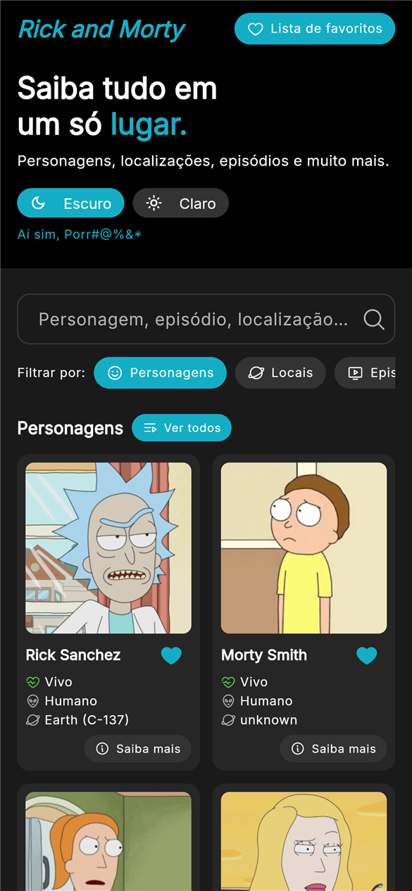
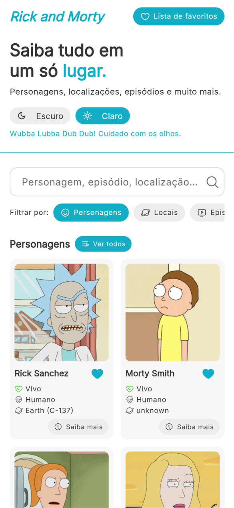
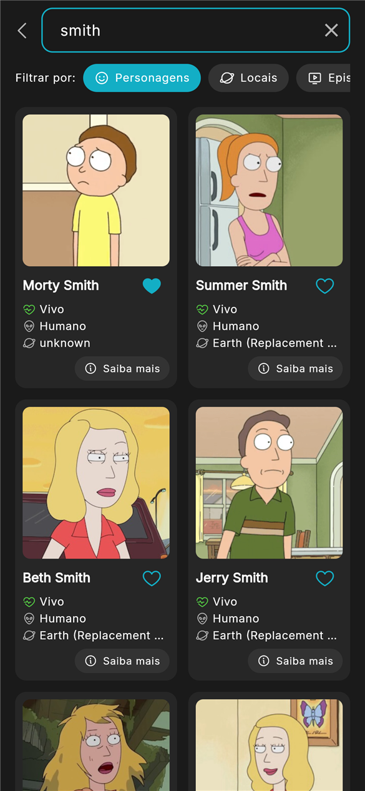
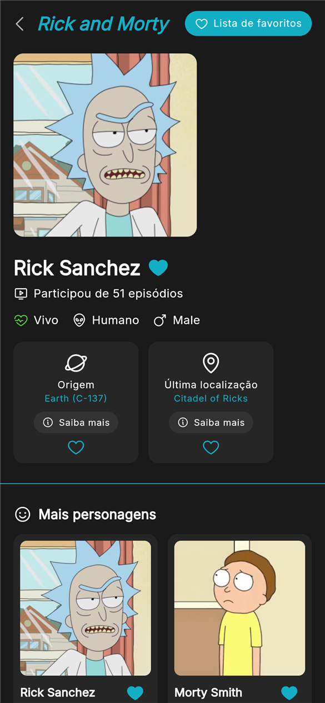
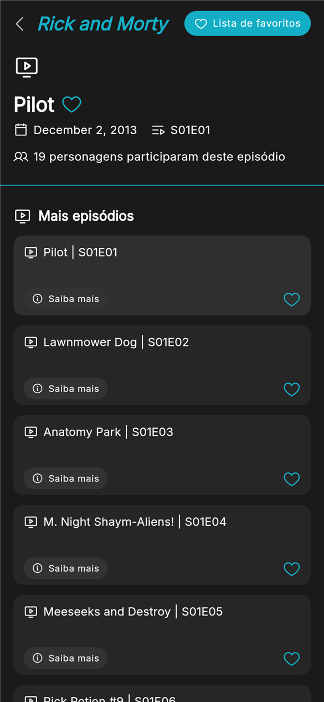
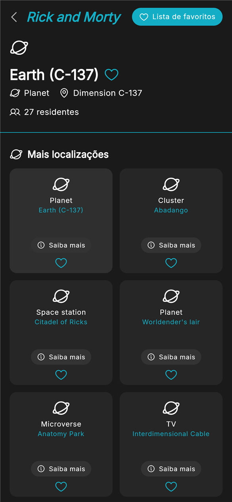
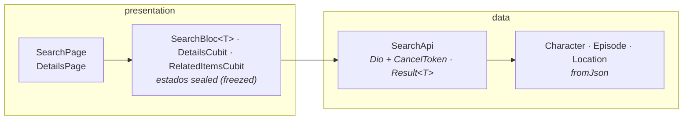

# Rick and Morty App

App Flutter para buscar **personagens, episódios e locais** da [Rick and Morty API](https://rickandmortyapi.com/), ver detalhes e salvar favoritos.

O que mudou em cada versão está no [CHANGELOG](CHANGELOG.md).

## Funcionalidades

- Página inicial no layout do protótipo do Figma: topo com seletor de tema **Escuro / Claro**, busca única com filtros (**Personagens / Localizações / Episódios**) e seções com prévia de cada tipo e **Ver todos**
- Busca por nome com **debounce de 400 ms** e **cancelamento** da requisição anterior
- **Paginação** com scroll infinito (`info.next` da API) e "tentar novamente" quando uma página falha
- Estados de **carregamento** (skeleton), **erro** com retry, **vazio** e **não encontrado** (a API responde 404 quando nada casa com a busca)
- **Detalhes** de cada item no layout do protótipo (personagem com cards de origem e última localização; episódio; local), com seção **"Mais ..."** e **paginação numerada**; acessíveis da busca, dos favoritos ou por deep link (`/details/:type/:id`)
- **Favoritos** persistidos localmente: salvar, listar, remover; o coração fica sincronizado em todas as telas
- Tema **claro/escuro** persistido, fonte Inter empacotada no app (funciona offline), cache de imagens em disco
- **Responsivo**: lista em celular, grade de 2 a 4 colunas em tablet/paisagem; detalhes lado a lado em telas largas

## Telas

<table>
  <tr>
    <th>Início (escuro)</th>
    <th>Início (claro)</th>
    <th>Busca</th>
  </tr>
  <tr>
    <td></td>
    <td></td>
    <td></td>
  </tr>
  <tr>
    <th>Personagem</th>
    <th>Episódio</th>
    <th>Local</th>
  </tr>
  <tr>
    <td></td>
    <td></td>
    <td></td>
  </tr>
  <tr>
    <th>Favoritos</th>
    <th></th>
    <th></th>
  </tr>
  <tr>
    <td></td>
    <td></td>
    <td></td>
  </tr>
</table>

> Capturas do app rodando com dados reais da API, em tela de celular (390 × 844).

## Requisitos

| Ferramenta | Versão usada |
| --- | --- |
| Flutter | 3.47.9 (mínimo 3.41) |
| Dart | 3.13.7 (mínimo 3.8) |
| Melos | 8.10.1 |

## Como rodar

```bash
dart pub global activate melos
melos bootstrap
flutter run
```

Os arquivos gerados (`*.freezed.dart`, `*.g.dart`) estão versionados, então não é preciso gerar código para rodar. Para regenerar depois de mudar um model:

```bash
melos run gen
```

## Testes e análise

```bash
melos run analyze    # dart analyze --fatal-infos em todo o workspace
melos run test       # flutter test em cada pacote
melos run coverage   # testes com cobertura; falha abaixo de 80%
```

### Cobertura

| Pacote | Linhas cobertas |
| --- | --- |
| core | 91,2% |
| favorites | 91,7% |
| search | 91,6% |
| **Total** | **91,5%** (1211/1324) |

O `melos run coverage` roda os testes de cada pacote e junta tudo em `coverage/lcov.info` na raiz, sem os arquivos gerados (`*.g.dart`, `*.freezed.dart`). O script [`tool/coverage_report.dart`](tool/coverage_report.dart) também avisa quando um arquivo com código não é carregado por nenhum teste, já que esses arquivos não aparecem no `lcov.info` e inflariam o percentual. No CI o relatório fica disponível como artefato (`coverage-lcov`) e o build falha abaixo de 80%.

Para ver por arquivo: `dart run tool/coverage_report.dart --files`.

Os testes cobrem as models com JSON real da API (`test/fixtures`), o `SearchApi` e o `FavoritesStorage` (sucesso, 404, timeout, sem rede, cancelamento, armazenamento corrompido), o `SearchBloc` (debounce, resposta antiga descartada, paginação), a injeção de dependências de cada módulo e as telas em cada estado (incluindo layout de tablet).

## Arquitetura

A raiz do repositório é um projeto Flutter padrão (o app). As features ficam em pacotes locais em `packages/`, ligados por **pub workspaces + Melos**. Cada feature tem só duas camadas: `data` (consumo da API ou do armazenamento local + models) e `presentation` (Bloc/Cubit, páginas e widgets).

```
lib/                 # app: main.dart, AppModule (rotas), AppWidget (tema, cubits globais)
android/  ios/       # projetos nativos
packages/
  core/              # Dio, Result, Failure, ResourceType, PaginatedList, tema, design system, AppRoutes
  favorites/         # favoritos (shared_preferences) + FavoritesCubit global
  search/            # busca + detalhes (Rick and Morty API)
tool/                # scripts de desenvolvimento (relatório de cobertura)
```

### Desenho da arquitetura

Dependências entre os pacotes (a seta aponta para quem é usado):


Camadas dentro de cada feature (exemplo do `search`): a tela lê o estado do Bloc/Cubit, que chama o `SearchApi` e recebe as models prontas.



- **Models** (`data/models`): uma classe por recurso da API (`Character`, `Episode`, `Location`, `FavoriteItem`), com `fromJson` e igualdade por valor (freezed). A UI usa as models direto; não há entidades separadas.
- **`SearchApi` e `FavoritesStorage`**: falam com a API e com o `shared_preferences` e nunca lançam exceção. Devolvem um `Result<T>` do `core`: `Success(data)` ou `Failed(failure)`, tratados com `switch`.
- `Failure` é uma sealed class (freezed): `notFound`, `network`, `tooManyRequests`, `server`, `cancelled`, `cache`, `unexpected`. O 404 da busca vira o estado **não encontrado**, não um erro genérico. O texto mostrado ao usuário fica na `FailurePresentation`, na UI.
- Estados de tela são sealed classes do freezed, tratados com `switch` exaustivo.
- Widgets de tela ficam em `presentation/widgets`, uma pasta por tela: `cards/` (cards de resultado e helpers), `home/`, `search/` e `details/`. As páginas só montam esses widgets e ligam os Blocs/Cubits; widgets genéricos (sem dependência de feature) ficam em `core/lib/src/ui`.

### Fluxo de uma busca

1. `SearchPage` envia `SearchQueryChanged` ao Bloc da aba visível.
2. O `SearchBloc<T>` aplica `debounce` (400 ms) + `restartable` (só a última busca importa).
3. O `SearchApi` cancela o `CancelToken` anterior do mesmo tipo, faz a requisição e devolve `Result<PaginatedList<T>>`, com a `DioException` já convertida em `Failure`.
4. O Bloc descarta respostas antigas (contador de geração) e emite `loading` → `success` / `empty` / `notFound` / `error`.

Um único `SearchBloc<T>` genérico atende as três abas: cada aba recebe o método do `SearchApi` do seu tipo (`searchCharacters`, `searchEpisodes`, `searchLocations`).

### Decisões

| Decisão | Motivo |
| --- | --- |
| `flutter_modular` **6.4** (não 7.x) | A 7.x é uma reescrita marcada como "work in progress" e define `context.read/watch` que conflitam com o flutter_bloc. A 6.x é estável e é a API conhecida (`Module`, `binds`, `routes`). |
| Fonte Inter empacotada (não `google_fonts`) | Os TTFs estáticos (pesos 400, 500, 700 e 800, licença SIL OFL) ficam em `packages/core/assets/fonts`: sem requisição nem troca de fonte no primeiro uso offline ou com rede lenta. A licença aparece na página de licenças do app (`AppTheme.registerFontLicenses`). |
| `flutter_bloc` + estados `sealed` | Cubits para carregar dados; Bloc só na busca, onde os transformers de evento dão debounce, `restartable` e `droppable` sem `Timer` à mão. |
| Sem camada `domain` | O app só exibe dados da API: entidades, use cases e contratos de repositório duplicavam as models e repassavam chamadas sem nenhuma regra. |
| `Result<T>` próprio (não `dartz`) | `Success`/`Failed` dizem o que cada caso é, ao contrário de `Left`/`Right`, e o `switch` do Dart trata os dois sem `fold`. |
| Favoritos com `shared_preferences` (JSON) | Simples e suficiente para o volume; o `FavoriteItem` guarda um snapshot mínimo (tipo, id, nome, subtítulo, imagem) para listar sem rede. |
| Detalhes carregam por `(tipo, id)` | A mesma rota serve para busca, favoritos e deep link. |
| Arquivos gerados versionados | O avaliador consegue rodar sem `build_runner`. |

> **Fonte e cores:** `AppTheme.fontFamily` (Inter) e as cores em `AppColors` foram tiradas do protótipo do Figma por inspeção visual e ainda serão conferidas no inspetor; trocar ali atualiza o app inteiro.

## Convenções

- Commits em [Conventional Commits](https://www.conventionalcommits.org/) (inglês)
- Uma branch só, a `main`: cada tarefa sai em uma `feature/*` ou `fix/*` criada a partir dela e volta por PR, com o CI (`ci.yml`) passando
- Release: tag `v*` em um commit da `main` (`release.yml`)

## Limitações conhecidas e próximos passos

Pontos levantados em revisão de código. Nenhum deles é um problema estrutural: são refinamentos planejados.

### Arquitetura e código

| # | Ponto | Situação atual | Direção |
| --- | --- | --- | --- |
| 1 | ~~Mensagens de UI no `Failure`~~ **(resolvido)** | Os estados guardam o `Failure` e a extensão `FailurePresentation` (`core/lib/src/ui`) gera título, mensagem e ícone de cada caso; `MessageView.failure` monta a tela de erro. O `Failure` do domínio não tem mais texto. | Levar os textos da `FailurePresentation` para ARB junto com o item 8. |
| 2 | ~~`Model.fromJson<T>` com `switch (T)`~~ **(resolvido)** | O `SearchApi` recebe o `fromJson` de cada model como função, verificado em tempo de compilação. O `Model<E>` não existe mais. | — |
| 3 | ~~`_guard` sem log~~ **(resolvido)** | O `Result.guard` (usado pelo `SearchApi` e pelo `FavoritesStorage`) envia ao `Result.reportError` toda exceção que vira `Failure.unexpected()` ou `Failure.cache()`; por padrão ela vai para o log do `dart:developer`. Falhas esperadas (rede, status HTTP, cancelamento) não são registradas. | Apontar o `Result.reportError` para um serviço de crash report (ex.: Crashlytics) quando o Firebase entrar no Dart (item 14). |
| 4 | `search` depende de `favorites` | Necessário por causa do botão de favorito nos cards e nos detalhes. | `search` receber um builder do botão ou uma interface definida em `core`. |
| 5 | Dois mecanismos de DI/ciclo de vida | O Modular entrega as instâncias e o `BlocProvider` as fecha, o que exige o `hide ModularWatchExtension`. `ThemeCubit` usa `BlocProvider.value` e `FavoritesCubit` usa `create`. O `flutter_modular` 6.x é uma versão antiga, um risco de manutenção a longo prazo. | Padronizar o ciclo de vida dos cubits globais e reavaliar o Modular quando a 7.x estabilizar. |
| 6 | ~~Repositório "isolado" criado à mão~~ **(resolvido)** | Cada cubit de "Mais ..." recebe um `SearchApi` próprio (`SearchApi(i.get<Dio>())`), sem o `_isolated(i)`. | — |
| 7 | ~~Arquivos grandes~~ **(resolvido)** | `details_page.dart` (463 → 108 linhas), `search_page.dart` (395 → 142) e `result_cards.dart` (269, removido) viraram widgets em arquivos próprios, agrupados por tela em `presentation/widgets/{cards,details,home,search}`. | — |

### Produto

| # | Ponto | Direção |
| --- | --- | --- |
| 8 | Textos fixos em pt-BR, sem `flutter_localizations`/ARB | Extrair os textos para ARB; as mensagens de erro já estão concentradas na `FailurePresentation`. |
| 9 | ~~Fonte Inter baixada pelo Google Fonts em runtime~~ **(resolvido)** | A Inter 4.1 está empacotada no `core` (pesos 400, 500, 700 e 800) e o `google_fonts` saiu das dependências. |
| 10 | Sem cache dos dados da API, só das imagens. Sem rede, só os favoritos aparecem (eles guardam um snapshot) | Cache local das respostas (ex.: última busca e detalhes já abertos). |

### CI e release

| # | Ponto | Direção |
| --- | --- | --- |
| 11 | ~~Actions fixadas por tag~~ **(resolvido)** | As Actions estão fixadas pelo SHA do commit (com a versão em comentário) e o `firebase-tools` em `14.27.0`. O Dependabot (`.github/dependabot.yml`) abre um PR semanal quando sai uma versão nova. |
| 12 | ~~Release a partir de qualquer tag `v*`~~ **(resolvido no workflow)** | O `release.yml` falha antes do build se o commit da tag não estiver na `main`. | Falta, no GitHub, um ruleset de tags `v*` (Settings → Rules → Rulesets → New tag ruleset) restringindo quem pode criá-las e apagá-las. |

### Firebase

| # | Ponto | Direção |
| --- | --- | --- |
| 13 | `android/app/google-services.json` versionado | É o normal no Firebase (a API key não é secreta), mas a chave precisa ter restrições no Google Cloud Console: pacote Android + SHA-1 do certificado. |
| 14 | Firebase só no Android: o plugin `google-services` e o `firebase-analytics` estão no `build.gradle.kts`, mas não há nada no Dart nem no iOS | Se o objetivo é só distribuir o APK pelo App Distribution, o plugin e o Analytics são desnecessários e podem sair; se o Analytics for desejado, integrar com `firebase_core`/`firebase_analytics` no Dart e configurar o iOS. |

### Prioridades

1. ~~Guardar o `Failure` nos estados e mover as mensagens para a UI (item 1).~~ Feito.
2. ~~Parser por função em `Model`/`PageModel` (item 2).~~ Feito.
3. ~~Logging no `_guard` (item 3).~~ Feito.
4. ~~Empacotar a fonte Inter (item 9).~~ Feito. Falta restringir a API key do Firebase (item 13), no Google Cloud Console.
5. ~~Quebrar `details_page` e `search_page` em widgets menores (item 7).~~ Feito.

## Próximas versões

> [!NOTE]
> Em uma versão futura o código passará por ajustes voltados a **melhorar a leitura** e **enxugar algumas classes**, sem mudar o comportamento do app.
